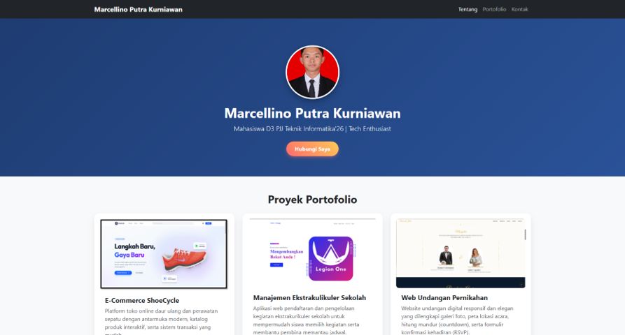

# Portfolio Pribadi | Advanced CSS & Bootstrap 5

Sebuah proyek halaman web portofolio pribadi responsif yang dikembangkan sebagai tugas praktikum **Modul 05: CSS Lanjutan & Bootstrap** pada mata kuliah **Workshop Desain Web**. Proyek ini mendemonstrasikan penggabungan _framework_ Bootstrap 5 dengan gaya kustom CSS3 modern (seperti _gradients, 2D transforms, rounded corners,_ dan _shadow effects_).

---

## 🚀 Fitur Utama & Kriteria CSS

- **Framework Bootstrap 5:** Memanfaatkan komponen utama seperti **Navbar** (responsif), **Grid System** (layout responsif), **Card** (wadah proyek), **Button**, **Tooltip** (informasi melayang interaktif), dan **Pagination**.
- **CSS Rounded Corners:** Penerapan `border-radius` kustom pada kartu proyek, foto profil melingkar, dan tombol penanda halaman.
- **CSS Gradients:** Latar belakang _Hero Header_ menggunakan `linear-gradient` warna korporat yang elegan serta tombol aksi gradasi interaktif.
- **CSS Shadow Effects:** Penerapan `box-shadow` dengan bayangan halus (_drop shadow_) pada kartu portofolio dan foto profil untuk memberikan efek kedalaman (_depth_).
- **CSS 2D Transforms:** Efek mikro-interaksi `transform: translateY(-8px) scale(1.02)` saat kursor menyorot (_hover_) kartu portofolio.
- **CSS Box Sizing:** Penerapan universal `* { box-sizing: border-box; }` untuk konsistensi perhitungan ukuran dan tata letak elemen.

---

## 🛠️ Teknologi yang Digunakan

- **HTML5** (Struktur Dokumen Semantik)
- **CSS3** (Kustom Styling, Gradients, 2D Transforms)
- **Bootstrap 5** (Grid System & Components CDN)
- **JavaScript ES6** (Inisialisasi Bootstrap Tooltip)

---

## 📂 Proyek yang Ditampilkan

1. **E-Commerce ShoeCycle:** Platform toko online daur ulang dan perawatan sepatu dengan katalog produk interaktif.
2. **Manajemen Ekstrakulikuler Sekolah:** Aplikasi web pendaftaran dan pengelolaan kegiatan ekstrakurikuler sekolah.
3. **Web Undangan Pernikahan:** Website undangan digital responsif yang dilengkapi galeri foto, peta lokasi, dan konfirmasi kehadiran (RSVP).

---

## 📸 Tangkapan Layar (Pratinjau Tampilan)

Berikut adalah tampilan antarmuka web portofolio pada berbagai ukuran perangkat:

### 1. Tampilan Desktop (PC View)

---

## 👨‍💻 Penulis

**Marcellino Putra Kurniawan**

- **NRP:** 3126510020
- **Program Studi:** D3 PJJ Teknik Informatika'26
- **Institusi:** Politeknik Elektronika Negeri Surabaya
- **GitHub:** [@marcellkurniawan](https://github.com/marcellkurniawan)

---

_Dibuat untuk memenuhi tugas praktikum 5 Workshop Desain Web (Semester 1)._
