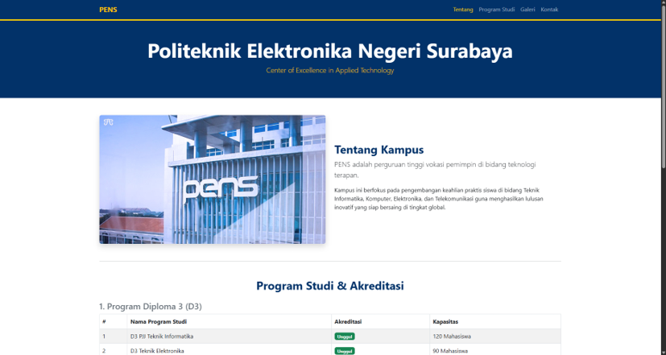
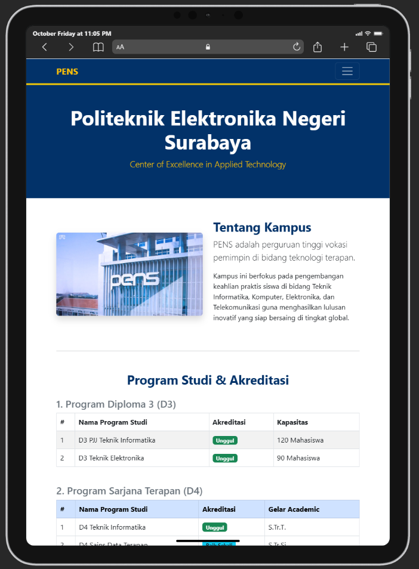
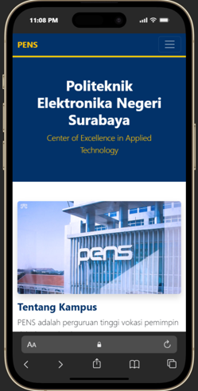

# Profil Kampus Responsif | Bootstrap 5 Framework

Sebuah proyek halaman web profil kampus responsif yang dikembangkan sebagai tugas praktikum **Modul 06: Bootstrap ke-01** pada mata kuliah **Workshop Desain Web**. Proyek ini mendemonstrasikan pemanfaatan _framework_ Bootstrap 5 dalam membangun tata letak web modern yang adaptif (_mobile-friendly_), terstruktur, dan elegan.

---

## 🚀 Fitur Utama & Kriteria Bootstrap

- **Layout & Containers:** Penggunaan kombinasi `.container-fluid` pada header/footer untuk tampilan penuh (_full-width_) dan `.container` pada area konten utama agar simetris.
- **Grid System Responsif:** Penerapan 12 kolom kisi (_Grid System_) menggunakan kelas `.row` dan `.col-md-*` untuk memastikan tampilan menyesuaikan perangkat secara otomatis dari ponsel hingga desktop.
- **Header & Navigasi:** Bilah navigasi (_Navbar_) interaktif yang dapat diciutkan (_collapse_) pada layar berukuran kecil.
- **Seksi "Tentang Kampus":** Penyajian profil institusi menggunakan kelas tipografi Bootstrap (`.display-4`, `.lead`) dan gambar berdampingan secara responsif.
- **Seksi "Program Studi" (Multi-Table Styling):** Menampilkan daftar program studi menggunakan 3 variasi pemformatan tabel Bootstrap yang berbeda:
  1. _Striped Table_ dengan _Dark Header_ (`.table-striped`, `.table-bordered`) untuk Program D3.
  2. _Hover Table_ dengan _Primary Header_ (`.table-hover`, `.table-bordered`) untuk Program D4.
  3. _Borderless Table_ dengan warna latar konteks (`.table-borderless`, `.table-warning`) untuk Program Pascasarjana.
- **Seksi "Galeri Kampus":** Galeri foto kegiatan berbentuk grid 3 kolom yang menggunakan kelas bingkai gambar `.img-thumbnail` dan `<figure>`.
- **Identitas Warna Kustom:** Mengintegrasikan skema warna identitas kampus khusus, yaitu `#023269` (Biru Utama) dan `#f3c907` (Kuning Emas) pada komponen Bootstrap.
- **Footer & Informasi Kontak:** Bagian bawah halaman memuat rincian kontak dan hak cipta institusi.

---

## 🛠️ Teknologi yang Digunakan

- **HTML5** (Struktur Dokumen Semantik)
- **CSS3** (Variabel Kustom & Styling Warna Kampus)
- **Bootstrap 5** (Grid System, Typography, Tables, Images, Components CDN)
- **JavaScript ES6 / Bootstrap Bundle** (Komponen Interaktif Navbar Toggle)

---

## 📂 Section Halaman yang Disediakan

1. **Header & Banner Hero:** Identitas Politeknik Elektronika Negeri Surabaya (PENS) dengan tampilan luas.
2. **Tentang Kampus:** Gambaran umum mengenai profil dan fokus pendidikan terapan.
3. **Program Studi & Akreditasi:** Informasi jenjang D3, D4, dan Pascasarjana dalam bentuk 3 gaya tabel interaktif.
4. **Galeri Kampus:** Dokumentasi fasilitas dan kegiatan mahasiswa.
5. **Footer:** Rincian alamat, email, nomor telepon, dan hak cipta.

---

## 📸 Tangkapan Layar (Pratinjau Tampilan)

Berikut adalah tampilan antarmuka web profil kampus pada berbagai ukuran perangkat:

### 1. Tampilan Desktop (PC View)

### 2. Tampilan Tablet (Pad View)

### 3. Tampilan Mobile (Mobile View)

---

## 👨‍💻 Penulis

**Marcellino Putra Kurniawan**

- **NRP:** 3126510020
- **Program Studi:** D3 PJJ Teknik Informatika '26
- **Institusi:** Politeknik Elektronika Negeri Surabaya

---

_Dibuat untuk memenuhi Tugas Praktikum 6 Workshop Desain Web (Semester 1)._
